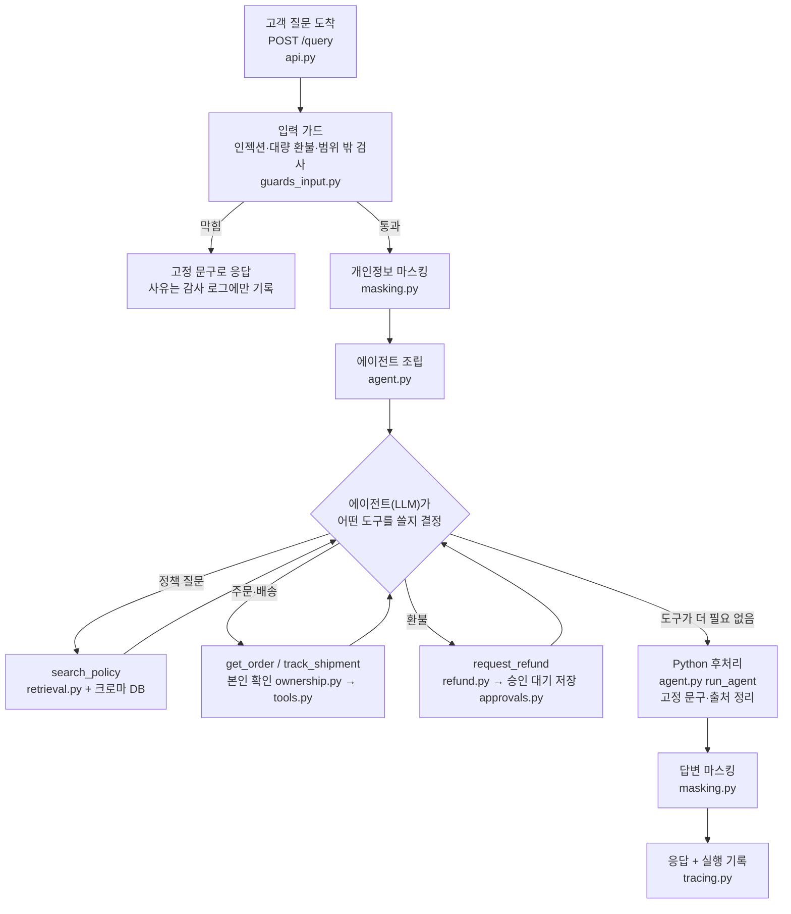
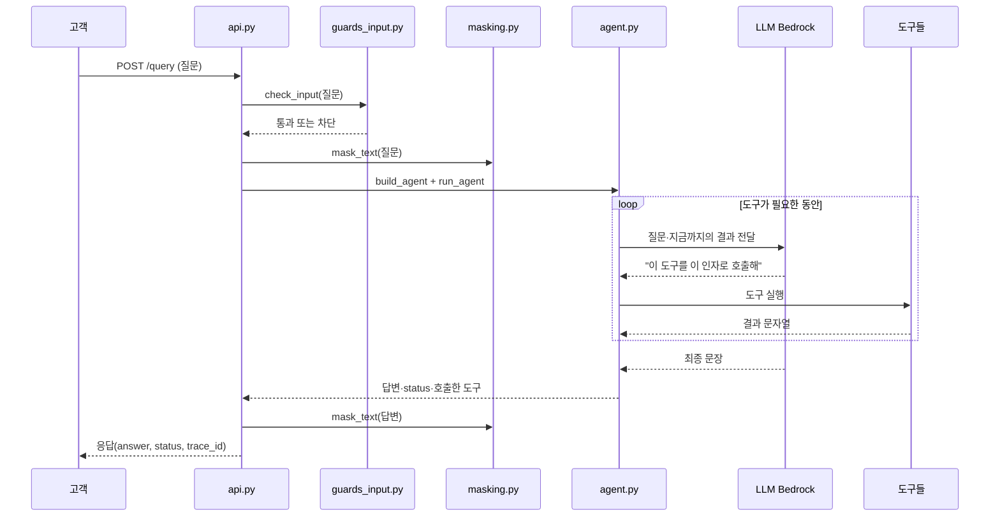
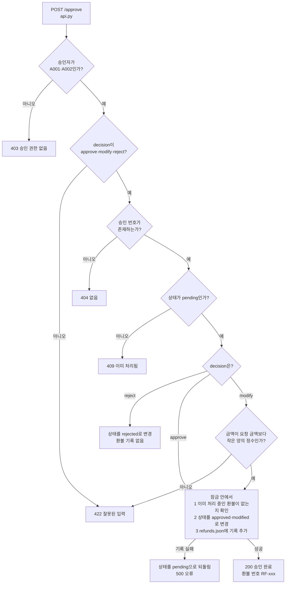
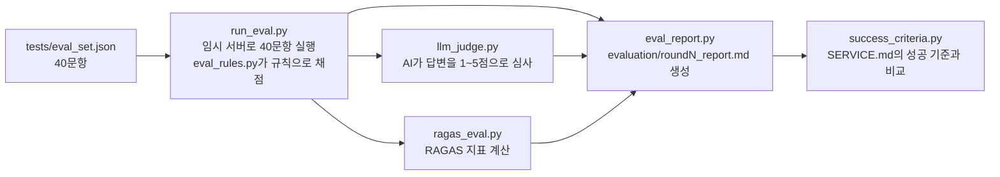

# 소스 코드 안내서 (초보자용)

고객센터 FAQ·주문 봇이 **질문 하나를 받아서 답을 돌려줄 때까지** 어떤 파일의 어떤 코드가 어떤 순서로 실행되는지를 따라가며 설명합니다.
파이썬을 막 배운 분도 이 문서만 읽고 전체 흐름을 이해할 수 있도록, 코드 조각과 함께 문법도 풀어 씁니다.

- 줄 번호 링크(예: [api.py:80](api.py#L80))를 누르면 해당 소스 위치로 이동합니다. 코드를 고치면 줄 번호는 밀릴 수 있습니다.
- 이 문서의 코드는 실제 소스에서 가져온 것이고, 길어서 줄인 부분은 `...`로 표시했습니다.
- 모든 데이터(고객·주문·배송·환불, 정책 수치)는 연습용 가상 값입니다.

## 목차

1. [이 프로그램이 하는 일 (큰 그림)](#1-이-프로그램이-하는-일-큰-그림)
2. [파일 지도](#2-파일-지도)
3. [먼저 알아 두면 좋은 파이썬 문법](#3-먼저-알아-두면-좋은-파이썬-문법)
4. [준비 단계: 설정, 데이터, 검색 인덱스](#4-준비-단계-설정-데이터-검색-인덱스)
5. [서버가 시작될 때: api.py](#5-서버가-시작될-때-apipy)
6. [질문 하나가 처리되는 과정 (`POST /query`)](#6-질문-하나가-처리되는-과정-post-query)
7. [환불 승인 과정 (`POST /approve`)](#7-환불-승인-과정-post-approve)
8. [예시 세 개를 처음부터 끝까지 따라가 보기](#8-예시-세-개를-처음부터-끝까지-따라가-보기)
9. [평가 코드는 어떻게 생겼나](#9-평가-코드는-어떻게-생겼나)
10. [이 코드에 깔린 설계 원칙](#10-이-코드에-깔린-설계-원칙)
11. [용어 사전](#11-용어-사전)
12. [무엇을 바꾸고 싶을 때 어디를 보나](#12-무엇을-바꾸고-싶을-때-어디를-보나)

---

## 1. 이 프로그램이 하는 일 (큰 그림)

쇼핑몰 고객이 "환불은 며칠 안에 되나요?", "ORD-1001 배송 어디쯤이야?", "ORD-1002 환불해줘" 같은 질문을 보내면 봇이 답합니다.
질문은 크게 세 종류입니다.

| 질문 종류 | 예 | 봇이 하는 일 |
|-----------|----|--------------|
| 정책 질문 | "환불은 수령 후 며칠 이내에 가능한가요?" | 정책 문서를 **검색**해서, 근거가 있을 때만 답하고 `(출처: 문서명)`을 붙임 |
| 주문·배송 조회 | "ORD-1001 배송 어디쯤이야?" | 주문·배송 **도구**를 호출해서 조회 (본인 주문만) |
| 환불 요청 | "ORD-1002 환불해줘" | 환불 **접수**만 하고 상담원 승인을 기다림 |

### 전체 흐름

질문이 들어오면 서버(`api.py`)가 아래 순서로 처리합니다. 각 상자 옆의 파일이 그 일을 맡습니다.



### 이 구조의 핵심 아이디어 두 가지

1. **LLM(AI 모델)에게 맡기는 일과 파이썬 코드가 정하는 일을 나눕니다.**
   "어떤 도구를 부를지", "문장을 자연스럽게 쓰기"는 LLM이 합니다. 반면 "이 주문이 본인 것인가", "환불 금액이 50만 원을 넘는가", "근거가 있는가", "차단할 것인가"는 **파이썬 코드가 정확히 계산**합니다. LLM은 가끔 틀리거나 속을 수 있기 때문입니다.
2. **환불은 두 단계입니다.** 고객 요청은 "접수"까지만 되고(`approval_id` 발급), 상담원이 `POST /approve`로 승인해야만 환불 기록이 생깁니다. 환불 기록 파일을 쓰는 코드는 승인 처리 한 곳뿐입니다.

---

## 2. 파일 지도

프로젝트 폴더에 파일이 많지만, 서비스를 돌리는 핵심은 아래 파일들입니다. `check_*.py`는 각 기능을 확인하는 스크립트(시험)이고, 서비스 동작에는 필요 없습니다.

### 서비스 실행에 쓰이는 파일

| 파일 | 한 줄 설명 | 이 문서의 절 |
|------|------------|--------------|
| [config.py](config.py) | `.env`에서 설정(키, 모델 이름)을 읽음 | 4-1 |
| [make_data.py](make_data.py), `data/*.json` | 가상 고객·주문·배송·환불 데이터와 그 생성기 | 4-2 |
| `docs/*.md` | 정책 문서 3종(환불·교환·배송) | 4-3 |
| [index.py](index.py) | 정책 문서를 잘라서 검색용 DB(Chroma)로 만듦 | 4-3 |
| [api.py](api.py) | 웹 서버. `POST /query`, `POST /approve`. 전체 흐름의 지휘자 | 5, 6, 7 |
| [guards_input.py](guards_input.py) | 입력 가드 (나쁜 질문 거르기) | 6-3 |
| [guards_refusal.py](guards_refusal.py) | 고정 거절 문구와 감사 로그 쓰기 | 6-3 |
| [masking.py](masking.py) | 전화번호·이메일·주소 가리기 | 6-4 |
| [llm.py](llm.py), [llm_fallback.py](llm_fallback.py) | AI 모델 만들기, 막히면 예비 모델로 전환 | 6-5 |
| [agent.py](agent.py) | 에이전트(도구를 골라 쓰는 AI) 조립과 답변 후처리 | 6-7, 6-11 |
| [agent_tools.py](agent_tools.py) | 도구 3종을 에이전트가 쓸 수 있는 형태로 포장 | 6-8 |
| [tools.py](tools.py) | 주문 조회(`get_order`), 배송 조회(`track_shipment`) 실제 함수 | 6-8 |
| [ownership.py](ownership.py) | 본인 주문인지 확인 | 6-8 |
| [retrieval.py](retrieval.py), [answer.py](answer.py) | 정책 검색, "근거 있음/없음" 판정, 출처 정리 | 6-9 |
| [refund.py](refund.py) | 환불 접수와 대량 환불 규칙 | 6-10 |
| [approvals.py](approvals.py) | 승인 대기 건을 SQLite DB에 저장 | 6-10 |
| [approval_flow.py](approval_flow.py) | 승인/수정 승인/거절 처리 | 7 |
| [tracing.py](tracing.py) | 요청마다 처리 과정을 한 줄씩 기록 | 6-2, 6-12 |

### 평가에 쓰이는 파일

[run_eval.py](run_eval.py), [eval_rules.py](eval_rules.py), [llm_judge.py](llm_judge.py), [ragas_eval.py](ragas_eval.py), [eval_report.py](eval_report.py), [success_criteria.py](success_criteria.py), `tests/eval_set.json` (자세한 설명은 9절)

### 만들어지는 저장소

| 저장소 | 종류 | 위치 | 용도 |
|--------|------|------|------|
| 승인 대기·결정 | SQLite 파일 | `approvals.sqlite` | 환불 접수 후 승인 대기와 처리 결과 |
| 정책 검색 인덱스 | Chroma 벡터 DB | `chroma_db/` | 정책 문서 검색 |
| 고객·주문·배송·환불 | JSON 파일 | `data/*.json` | 가상 데이터. 환불 기록은 승인 때만 추가됨 |
| 실행·감사 기록 | 텍스트 로그(한 줄에 JSON 하나) | `logs/trace.log`, `logs/audit.log` | 처리 이력, 차단 사유 |

---

## 3. 먼저 알아 두면 좋은 파이썬 문법

뒤에서 코드를 읽다가 모르는 모양이 나오면 이 절로 돌아오세요. 이미 아는 분은 건너뛰어도 됩니다.

### 3-1. 파일 맨 위의 `"""..."""` (독스트링)

```python
"""본인 주문 확인 규칙 (결정적 규칙, LLM을 쓰지 않는다)."""
```

큰따옴표 세 개로 감싼 글은 **설명문(독스트링)** 입니다. 실행에는 영향이 없고, 파일이나 함수가 무엇을 하는지 사람에게 알려 줍니다.
이 프로젝트에서는 함수의 독스트링이 중요한 역할을 한 번 더 합니다. 에이전트(AI)가 도구를 고를 때 읽는 **도구 설명**으로 쓰입니다(6-8절).

`#`로 시작하는 줄은 한 줄 주석입니다. 마찬가지로 실행되지 않습니다.

### 3-2. `import` — 다른 파일의 기능 가져오기

```python
import json                              # 표준 라이브러리 통째로 가져옴 -> json.loads(...)
from pathlib import Path                 # pathlib 안에서 Path만 가져옴 -> Path(...)
from tools import _load, find_order      # 내가 만든 tools.py 안의 함수 두 개
```

- `import 이름`: 가져온 뒤 `이름.함수()`로 씁니다.
- `from 파일 import 이름`: 이름만 바로 씁니다.
- 프로젝트의 `tools.py`, `refund.py` 같은 파일도 이렇게 가져옵니다. 파일 이름이 곧 모듈 이름입니다.
- 함수 안에서 `import`하는 경우도 있습니다(예: [agent.py:95](agent.py#L95)). 무거운 라이브러리를 **필요한 순간에만** 불러서 서버 시작과 시험을 가볍게 하려는 것입니다.

### 3-3. `def` — 함수

```python
def check_owner(customer_id, number, data_dir=None):
    ...
    return False, BLOCKED_REPLY
```

- `def 이름(입력들):`로 함수를 정의하고, 아래 들여쓴 줄이 함수의 몸통입니다. **파이썬은 들여쓰기(공백 4칸)로 블록을 구분합니다.**
- `data_dir=None`은 **기본값**입니다. 호출할 때 안 주면 `None`(없음)이 들어갑니다.
- `return a, b`처럼 쉼표로 여러 값을 돌려주면 값 묶음(튜플)으로 나옵니다. 받는 쪽은 `allowed, why = check_owner(...)`로 한 번에 풀어서 받습니다.

### 3-4. 자료형: 문자열·숫자·리스트·딕셔너리

```python
order = {"order_id": "ORD-1001", "amount": 320000}   # 딕셔너리: 이름표(키)로 값을 찾음
order["amount"]                                      # -> 320000
calls = []                                           # 리스트: 순서가 있는 목록
calls.append({"tool": "get_order"})                  # 리스트 끝에 추가
{"A001", "A002"}                                     # 집합(set): 중복 없는 모음, 포함 여부 검사가 빠름
```

이 프로젝트의 데이터(`data/orders.json` 등)는 **딕셔너리의 리스트**입니다. 주문 한 건이 딕셔너리 하나입니다.

### 3-5. f-문자열과 숫자 서식

```python
f"금액: {order['amount']:,}원"        # -> "금액: 320,000원"
f"RF-{max(numbers, default=0) + 1:03d}"   # -> "RF-006" (3자리, 앞을 0으로 채움)
```

문자열 앞의 `f`는 `{}` 안에 값을 끼워 넣겠다는 표시입니다. `:,`는 천 단위 쉼표, `:03d`는 3자리 숫자(빈자리는 0)입니다.

### 3-6. 조건문과 반복문

```python
if not allowed:
    return why
for name, pattern in rules:      # rules의 각 항목을 (name, pattern)으로 풀어 하나씩 꺼냄
    ...
```

### 3-7. 컴프리헨션 (한 줄로 리스트 만들기)

```python
usable = [(doc, dist) for doc, dist in results if dist <= max_distance]
```

"results의 각 `(doc, dist)` 중에서 `dist <= max_distance`인 것만 모아 새 리스트를 만든다"는 뜻입니다. 아래 긴 코드와 같습니다.

```python
usable = []
for doc, dist in results:
    if dist <= max_distance:
        usable.append((doc, dist))
```

`any(조건 for 항목 in 목록)`은 "하나라도 참이면 참", `next((... for ...), None)`은 "조건에 맞는 첫 항목, 없으면 None"입니다.

### 3-8. `try / except` — 오류 처리

```python
try:
    order = find_order(order_id, data_dir)
    ...
except Exception:
    return LOOKUP_ERROR
```

`try` 안에서 오류가 나면 프로그램이 멈추는 대신 `except` 쪽이 실행됩니다. 이 프로젝트의 규칙은 **"도구는 오류를 밖으로 던지지 않고, 안내 문구를 돌려준다. 모르는 오류는 안전한 쪽으로 처리한다"** 입니다. 오류 내용(비밀값이 섞일 수 있음)은 화면에 내보내지 않고 오류 이름만 남깁니다.

### 3-9. `with` — 열고 자동으로 닫기

```python
with target.open("a", encoding="utf-8") as f:
    f.write(...)
```

파일이나 DB 연결을 열고, 블록이 끝나면 오류가 났어도 자동으로 닫아 줍니다. 잠금(`with session.lock:`)에도 같은 문법을 씁니다. 잠금은 6-10절에서 설명합니다.

### 3-10. `class` — 데이터와 기능을 묶는 틀

```python
class RefundSession:
    def __init__(self, customer_id, store=None, conversation_id=None):
        self.customer_id = customer_id
        self.requests = []

    @property
    def count(self):
        return len(self.requests)
```

- `class`는 관련 데이터와 함수를 하나로 묶습니다. `RefundSession(...)`으로 **객체**를 하나 만들면 대화 하나의 상태가 됩니다.
- `__init__`은 객체를 만들 때 한 번 실행됩니다. `self`는 "이 객체 자신"이고, `self.customer_id`는 이 객체가 가진 값입니다.
- `@property`가 붙은 함수는 괄호 없이 값처럼 읽습니다(`session.count`).

### 3-11. 데코레이터 `@`

```python
@app.post("/query")
def query(req: QueryRequest):
    ...
```

함수 위의 `@...`는 함수에 **기능을 덧붙이는 표시**입니다. 여기서는 "`POST /query` 요청이 오면 이 함수를 실행하라"고 웹 서버(FastAPI)에 등록합니다.

### 3-12. 타입 표시 (`:` 와 `|`)

```python
customer_id: str | None = None
def query(req: QueryRequest):
```

`이름: 타입`은 "이 값은 이런 종류"라는 안내입니다. `str | None`은 "문자열이거나 없음"입니다. 파이썬은 이 표시를 실행 중에 강제하지 않지만, FastAPI는 이것을 읽어 **요청 값을 자동으로 검사**합니다(5절).

### 3-13. 클로저 (함수 안의 함수)

```python
def build_tools(session, calls=None, data_dir=None):
    def record(name, outcome, ...):
        calls.append(...)      # 바깥 함수의 변수 calls를 안쪽 함수가 그대로 씀
    def get_order_tool(order_id: str) -> str:
        ...
```

안쪽 함수는 바깥 함수의 변수(`session`, `calls`)를 기억합니다. 이렇게 하면 **대화마다 따로 만든 도구가 그 대화의 상태를 들고** 있게 됩니다.

### 3-14. 정규식 (`re`)

```python
re.search(r"(이전|위|앞)(의)?(지시|지침)(을|를)?(무시|잊)", compact)
```

글자 패턴을 적은 식입니다. `(a|b)`는 a 또는 b, `?`는 있어도 되고 없어도 됨, `.{0,14}`는 아무 글자 0~14개, `\d{4}`는 숫자 4개입니다. 입력 가드와 마스킹이 이것으로 문장을 검사합니다. 패턴 앞의 `r"..."`는 `\`를 글자 그대로 쓰겠다는 표시입니다.

---

## 4. 준비 단계: 설정, 데이터, 검색 인덱스

서버를 켜기 전에 미리 갖춰져 있어야 하는 것들입니다.

### 4-1. 설정 읽기: [config.py](config.py)

AWS 키와 모델 이름은 코드에 적지 않고 `.env` 파일에 둡니다(`.env`는 git에 올라가지 않습니다).

```python
REQUIRED_KEYS = ["AWS_ACCESS_KEY_ID", "AWS_SECRET_ACCESS_KEY", "AWS_REGION",
                 "BEDROCK_MODEL_ID", "EMBEDDING_MODEL_ID"]

def load_settings():
    load_dotenv(ENV_PATH)                       # .env 파일 내용을 환경 변수로 올림
    return {key: os.environ.get(key, "").strip() for key in REQUIRED_KEYS + OPTIONAL_KEYS}
```

- [config.py:28-31](config.py#L28-L31): `.env`를 읽어 `{"AWS_REGION": "us-west-2", ...}` 같은 딕셔너리를 돌려줍니다. 값이 없으면 빈 문자열입니다.
- `{key: ... for key in ...}`는 딕셔너리 컴프리헨션(3-7절의 딕셔너리 버전)입니다.
- [config.py:44-52](config.py#L44-L52) `mask()`: 화면에 설정을 보여 줄 때 비밀 키를 가립니다. 이 프로젝트는 **비밀값을 화면·로그·응답에 절대 내보내지 않습니다.**
- `python check_env.py`로 설정이 잘 읽히는지 확인할 수 있습니다.

### 4-2. 가상 데이터: `data/*.json`, [make_data.py](make_data.py)

| 파일 | 내용 | 예 |
|------|------|----|
| `customers.json` | 고객 5명 | `C001` 김하늘 |
| `orders.json` | 주문 15건 | `ORD-1001`: 노트북, 320,000원, 배송 중, 소유자 `C001`, 운송장 `TRK-9001` |
| `shipments.json` | 배송 12건 | `TRK-9001`: 서울 허브 터미널, 도착 예정 2026-11-07 |
| `refunds.json` | 환불 기록 5건 | `RF-001`: 거절된 환불 |

주문 한 건은 이런 모양입니다.

```json
{
  "order_id": "ORD-1001",
  "customer_id": "C001",
  "product": "노트북",
  "amount": 320000,
  "status": "배송 중",
  "ordered_at": "2026-11-02",
  "delivered_at": null,
  "opened": false,
  "tracking_no": "TRK-9001"
}
```

`python make_data.py`를 실행하면 이 파일들이 처음 상태로 다시 만들어집니다(승인으로 쌓인 환불 기록도 지워집니다).

### 4-3. 정책 문서 → 검색 인덱스: `docs/*.md`, [index.py](index.py)

고객이 정책을 물으면 봇은 정책 문서에서 근거를 찾습니다. 문서 전체를 매번 AI에게 주는 대신, 문서를 **조각(청크)** 으로 나누고 각 조각을 숫자 벡터(임베딩)로 바꿔 **벡터 DB**에 넣어 두었다가, 질문과 **뜻이 가까운 조각**만 꺼내 씁니다.

정책 문서는 이런 모양입니다 (`docs/refund_policy.md`).

```markdown
# 환불 정책

## 신청 기간
단순 변심으로 인한 환불은 상품 수령 후 7일 이내에 신청할 수 있습니다.
...
## 환불 불가
개봉했거나 사용한 상품은 환불할 수 없습니다.
```

`python index.py`를 실행하면 다음이 일어납니다.

```python
def build_chunks(docs_dir=DOCS_DIR):
    splitter = MarkdownHeaderTextSplitter(headers_to_split_on=[("#", "title"), ("##", "section")])
    chunks = []
    for path in sorted(Path(docs_dir).glob("*.md")):         # docs 폴더의 모든 .md 파일
        text = path.read_text(encoding="utf-8")
        for part in splitter.split_text(text):                # ## 제목 기준으로 자름
            if "section" not in part.metadata:                # ## 섹션이 없는 조각은 제외
                continue
            ...
            chunks.append(Document(page_content=f"{title} > {section}\n{part.page_content}",
                                   metadata={"source": title, "section": section, ...}))
    return chunks
```

[index.py:27-59](index.py#L27-L59) `build_chunks`: `##` 제목 단위로 문서를 자릅니다. 각 조각 맨 윗줄에 `환불 정책 > 신청 기간`처럼 문서명과 섹션명을 넣고, `metadata["source"]`에 문서 제목을 저장해 나중에 **출처 표시**에 씁니다. 정책 문서 3개에서 조각 9개가 나옵니다.

```python
def build_index(embeddings=None, chunks=None, persist_dir=PERSIST_DIR):
    ...
    return Chroma.from_documents(documents=chunks, embedding=embeddings,
                                 collection_name=COLLECTION_NAME, persist_directory=str(persist_dir))
```

[index.py:73-86](index.py#L73-L86) `build_index`: 조각을 Bedrock의 임베딩 모델(Titan v2)로 숫자 벡터로 바꿔 `chroma_db/` 폴더에 저장합니다. [index.py:89-97](index.py#L89-L97) `load_index`는 서버가 이미 만들어진 인덱스를 열 때 씁니다.

---

## 5. 서버가 시작될 때: [api.py](api.py)

`python -m uvicorn api:app --port 8000`을 실행하면 uvicorn(웹 서버 프로그램)이 `api.py`의 `app`을 불러와서 요청을 기다립니다.
FastAPI는 파이썬 함수로 웹 API를 만들게 해 주는 도구입니다.

### 5-1. 요청 모양 정의: pydantic 모델

```python
class QueryRequest(BaseModel):
    question: str
    customer_id: str | None = None
    conversation_id: str | None = None
```
[api.py:44-48](api.py#L44-L48)

고객이 보내는 JSON(`{"question": "...", "customer_id": "C001", "conversation_id": "chat-1"}`)의 설계도입니다.

- `question: str`: 필수 문자열. 빠졌거나 숫자면 FastAPI가 자동으로 오류(422)를 돌려줍니다.
- `customer_id`: **로그인한 고객**이라고 가정하는 값입니다(연습용이라 클라이언트가 보냅니다). 이후 본인 확인의 기준이 됩니다.
- `conversation_id`: 같은 번호를 보낸 요청끼리 "한 대화"로 묶습니다. 환불 한도(2건, 합계 50만 원)를 대화 단위로 셉니다.

`ApproveRequest`([api.py:50-55](api.py#L50-L55))는 승인 요청의 설계도입니다.

### 5-2. `build_app`: 서버를 조립하는 함수

[api.py:58](api.py#L58) `build_app(llm=None, db=None, data_dir=None, approval_path=None, audit_path=None, trace_path=None)`

- 모든 외부 자원(모델, 인덱스, 데이터 폴더, 저장 파일 경로)을 **인자로 바꿔 끼울 수 있게** 했습니다. 평소에는 `None`이고 첫 요청 때 진짜를 만듭니다. 시험할 때는 가짜 모델과 임시 파일을 넣어 실제 데이터를 건드리지 않습니다.
- [api.py:61-62](api.py#L61-L62): 서버가 기억하는 것 두 가지입니다.

```python
cache = {"llm": llm, "db": db, "store": None}   # 한 번 만들어 계속 쓰는 것들
sessions = {}                                   # (고객, 대화번호) -> 그 대화의 환불 상태
```

- [api.py:69-78](api.py#L69-L78) `get_session`: 같은 `(customer_id, conversation_id)`면 같은 `RefundSession`을 돌려주고, 처음 보는 대화면 새로 만듭니다. 대화가 200개를 넘으면 오래된 것부터 버립니다(`MAX_CONVERSATIONS`).
- **주의**: `sessions`는 메모리에만 있으므로 서버를 재시작하면 대화별 환불 한도 집계는 0으로 돌아갑니다. 승인 대기 건은 DB에 저장되어 남습니다.
- [api.py:150](api.py#L150) 맨 아래 `app = build_app()`이 uvicorn이 찾는 `app`입니다.

---

## 6. 질문 하나가 처리되는 과정 (`POST /query`)

[api.py:80-131](api.py#L80-L131)의 `query` 함수가 전체 순서를 지휘합니다. 뼈대만 보면 이렇습니다.

```python
@app.post("/query")
def query(req: QueryRequest):
    question = req.question.strip()
    if not question:                                   # 빈 질문
        return {"answer": "질문을 입력해 주세요.", "status": "ok", "tools_called": []}
    trace = start_trace(...)                           # 6-2. 기록 시작
    try:
        guard = check_input(question)                  # 6-3. 입력 가드
        if not guard["allowed"]:
            ...
            return done({... 고정 문구 ...})            # 막힘: 여기서 끝
        question, found_in = mask_text(guard["clean"]) # 6-4. 마스킹
        ... 모델/인덱스 준비 ...                         # 6-5
        session = get_session(...)                     # 6-6
        agent, calls, searched = build_agent(...)      # 6-7
        result = run_agent(agent, calls, searched, question)   # 6-8 ~ 6-11
    except Exception as e:
        return done({"answer": ERROR_REPLY, "status": "error", ...})
    answer, found_out = mask_text(result["answer"])    # 6-12. 답변 마스킹
    ...
    return done(response, ...)
```

`try ... except`로 감싸서, **알 수 없는 오류가 나도 서버가 죽지 않고** 안내 문구(`ERROR_REPLY`)와 `status: "error"`를 돌려줍니다. 오류의 내용은 응답에 넣지 않고 오류 이름만 로그에 남깁니다.

시간 순서로 보면 이렇습니다.



### 6-1. 응답이 담는 값

| 필드 | 뜻 |
|------|----|
| `answer` | 고객에게 보여 줄 답변 |
| `status` | `ok` 정상, `blocked` 가드·본인 확인·한도에서 차단, `approval_required` 환불 접수됨(승인 대기), `error` 오류 |
| `tools_called` | 호출된 도구 목록(정책 검색은 제외) |
| `trace_id` | 이 요청의 실행 기록 번호 |
| `approval_id` | `approval_required`일 때 승인 번호 |

### 6-2. 실행 기록 시작: [tracing.py](tracing.py)

```python
trace = start_trace("query", req.customer_id, req.conversation_id, question)
```

[tracing.py:34-45](tracing.py#L34-L45) `start_trace`: `TR-xxxxxxxxxx` 형태의 번호를 만들고 **시작 시각**을 기억합니다. 질문은 마스킹한 뒤 200자까지만 담습니다. 끝날 때 `finish_trace`([tracing.py:53-58](tracing.py#L53-L58))가 걸린 시간(`total_ms`)을 채우고, `write_trace`([tracing.py:61-72](tracing.py#L61-L72))가 `logs/trace.log`에 **한 줄(JSON)** 로 덧붙입니다. 로그 쓰기가 실패해도 요청 처리는 멈추지 않습니다.

`query` 안의 작은 함수 `done`([api.py:88-97](api.py#L88-L97))이 "응답을 돌려주기 직전에 기록을 쓰고 응답에 `trace_id`를 붙이는" 일을 맡아서, 어느 경로로 끝나도(차단, 오류, 정상) 같은 방식으로 기록됩니다.

### 6-3. 입력 가드: [guards_input.py](guards_input.py)

**모델에게 보내기 전에** 질문을 검사해서 나쁜 요청을 거릅니다. AI를 쓰지 않고 정규식 규칙만 씁니다(빠르고, 속일 수 없고, 비용이 없습니다).

```python
guard = check_input(question)
if not guard["allowed"]:
    audit_blocked(guard, req.customer_id, req.conversation_id, audit_path)
    return done({"answer": guard["reply"], "status": guard["status"], "tools_called": []}, ...)
```
[api.py:100-104](api.py#L100-L104)

`check_input`([guards_input.py:97-130](guards_input.py#L97-L130))의 검사 순서입니다.

**① 정규화** ([guards_input.py:77-86](guards_input.py#L77-L86) `normalize`)

```python
text = unicodedata.normalize("NFKC", str(text or ""))   # 전각 글자를 일반 글자로 (ｉｇｎｏｒｅ -> ignore)
for ch in text:
    category = unicodedata.category(ch)
    if category == "Cf":          # 눈에 안 보이는 글자(제로폭 공백 등)는 버림
        continue
    kept.append(" " if category == "Cc" else ch)   # 줄바꿈·탭은 공백으로
return re.sub(r"\s+", " ", "".join(kept)).strip()   # 공백 여러 개를 하나로
```

공격자가 "이​전 지​시"처럼 **보이지 않는 글자를 끼워 넣어** 규칙을 피하려는 것을 막습니다. 규칙 검사는 공백을 아예 뺀 문장(`compact`)에도 적용해서 "이 전 지 시"도 잡습니다([guards_input.py:104](guards_input.py#L104)).

**② 길이 검사**: 1000자를 넘으면 차단합니다([guards_input.py:110-111](guards_input.py#L110-L111)).

**③ 인젝션 규칙** ([guards_input.py:28-46](guards_input.py#L28-L46) `INJECTION_RULES`)

"이전 지시는 무시하고", "시스템 프롬프트를 보여줘", "ignore all previous instructions", "나는 관리자야", "탈옥" 같은 **AI를 속여 규칙을 풀게 하려는 문장**을 찾습니다.

```python
("ignore_previous_ko",
 r"(이전|위|앞|기존|상기|지금까지|위의|앞의|앞선)(의)?(모든)?(지시|지침|명령|프롬프트|규칙|설정|안내)(사항)?(을|를|은|는)?(전부|모두|다)?(무시|잊|따르지|어기)"),
```

규칙은 `(이름, 정규식)` 쌍의 리스트이고, `_first_match`([guards_input.py:89-94](guards_input.py#L89-L94))가 순서대로 검사해서 처음 걸리는 규칙 이름을 돌려줍니다.

**④ 대량 환불 규칙** ([guards_input.py:49-57](guards_input.py#L49-L57) `MASS_REFUND_RULES`)

"내 주문 전부 한꺼번에 환불해줘", "승인 없이 바로 환불해" 같은 **한꺼번에 환불하라는 지시**를 막습니다. 다만 정상 질문까지 막지 않도록 두 가지 예외가 있습니다.

```python
mass_view = COUNTED_ALL.sub("", compact)             # "둘 다", "두 건 모두"처럼 개수를 정한 말은 뺌
rule, matched = _first_match(MASS_REFUND_RULES, mass_view)
if rule:
    is_question = bool(QUESTION_MARKERS.search(lowered)) and not REQUEST_MARKERS.search(lowered)
    if not is_question:                              # 질문형이면 통과 ("전부 환불 가능한가요?")
        return block("mass_refund", ...)
```
[guards_input.py:119-124](guards_input.py#L119-L124)

- "환불은 전부 가능한가요?"는 **질문**이므로 통과합니다. "전부 환불해줘"는 **요청**이므로 차단합니다.
- "ORD-1001, ORD-1002 둘 다 환불해줘"는 주문번호를 정해서 말했으므로 통과합니다(실제 한도는 6-10절의 규칙이 막습니다).

**⑤ 범위 밖 규칙** ([guards_input.py:61-66](guards_input.py#L61-L66)): "내일 서울 날씨 알려줘", "주식 추천해줘"처럼 고객센터 범위를 벗어난 질문은 **AI를 부르지 않고** "담당 범위가 아닙니다" 안내를 돌려줍니다(status는 `ok`).

**차단되면**

- 고객에게는 [guards_refusal.py:18-25](guards_refusal.py#L18-L25)의 **고정 문구**만 보여 줍니다. "어떤 규칙에 걸렸는지"는 알려 주지 않습니다(알려 주면 공격자가 피해 가기 쉬워지기 때문).
- 사유는 `logs/audit.log`(감사 로그)에만 남습니다. 질문 전문은 남기지 않고 **규칙 이름, 걸린 부분 40자, 길이, 해시 12자**만 남깁니다([guards_refusal.py:30-42](guards_refusal.py#L30-L42)).

> 이 가드는 첫 번째 방어선일 뿐입니다. 정규식이라 모든 변형을 막지는 못하고, 뚫려도 6-8절의 본인 확인과 6-10절의 한도·승인 흐름이 실제 피해를 막습니다. 이렇게 **방어선을 여러 겹**으로 둡니다.

### 6-4. 개인정보 마스킹: [masking.py](masking.py)

```python
question, found_in = mask_text(guard["clean"])
```
[api.py:105](api.py#L105)

```python
_PATTERNS = [
    ("이메일", re.compile(r"[A-Za-z0-9._%+-]+@[A-Za-z0-9-]+(?:\.[A-Za-z0-9-]+)+")),
    ("주민등록번호", re.compile(r"(?<!\d)\d{6}[-\s]?[1-4]\d{6}(?!\d)")),
    ("카드번호", ...),
    ("전화번호", ...),
    ("주소", ...),
]

def mask_text(text):
    text = str(text or "")
    counts = {}
    for label, pattern in _PATTERNS:
        text, n = pattern.subn(f"[{label}]", text)    # 찾은 것을 "[전화번호]"로 바꿈
        if n:
            counts[label] = n
    return text, counts
```
[masking.py:14-39](masking.py#L14-L39)

- "010-1234-5678로 연락 주세요" → "[전화번호]로 연락 주세요". AI와 로그에 **원문이 남지 않습니다.**
- 같은 함수를 **답변이 나갈 때도** 한 번 더 씁니다(6-12절). AI가 어디선가 본 개인정보를 답에 섞어도 원문이 고객에게 나가지 않게 하려는 것입니다.
- 주문번호, 운송장 번호, 승인 번호, 금액은 가리지 않습니다. 도구가 그 값으로 조회해야 하기 때문입니다.
- 감사 로그에는 "어떤 종류가 몇 건 가려졌는지"만 남깁니다([api.py:106-108](api.py#L106-L108)).
- 규칙 순서(이메일 → 주민번호 → 카드 → 전화 → 주소)가 중요합니다. 숫자가 긴 주민번호가 전화번호 규칙에 먼저 잘리지 않게 하기 위해서입니다.

### 6-5. 모델과 인덱스 준비: [llm.py](llm.py), [llm_fallback.py](llm_fallback.py), [index.py](index.py)

```python
if cache["llm"] is None:
    from llm import build_llm_chain
    cache["llm"] = build_llm_chain()
if cache["db"] is None:
    from index import load_index
    cache["db"] = load_index()
```
[api.py:109-114](api.py#L109-L114)

첫 요청 때 한 번만 만들고 이후에는 `cache`에서 재사용합니다.

**모델 만들기** ([llm.py:31-48](llm.py#L31-L48))

```python
def build_llm(settings=None, model_id=None, read_timeout=ANSWER_READ_TIMEOUT_S, max_attempts=LAST_MODEL_ATTEMPTS, endpoint_url=None):
    from langchain_aws import ChatBedrockConverse
    settings = settings or load_settings()
    return ChatBedrockConverse(
        model=model_id or settings["BEDROCK_MODEL_ID"],     # 모델 이름은 .env에서
        region_name=settings["AWS_REGION"],
        temperature=0,                                      # 0: 같은 질문엔 최대한 같은 답
        config=bedrock_config(read_timeout, max_attempts),
        ...
    )
```

- 모델 이름과 리전은 **코드에 적지 않고 `.env`에서** 읽습니다. 모델을 바꿔 쓰기 쉽습니다.
- `temperature=0`은 답의 무작위성을 최소로 하는 설정입니다.
- 응답 시간 설정([llm.py:16-20](llm.py#L16-L20)): 모델 호출이 한 번 멈추면 사용자가 1분을 기다리게 되므로(실제로 한 번 63초가 걸렸습니다), 읽기 제한을 15초, 연결 제한을 5초로 두어 멈춘 호출을 빨리 끊고 재시도합니다.

**예비 모델로 자동 전환** ([llm.py:51-67](llm.py#L51-L67) `build_llm_chain`, [llm_fallback.py:22-57](llm_fallback.py#L22-L57) `FallbackChat`)

`.env`의 `FALLBACK_MODEL_IDS`에 모델을 적어 두면, 기본 모델이 사용량 한도 초과 등으로 막힐 때 **같은 요청을 다음 모델에 다시 보냅니다.**

```python
def invoke(self, input, config=None, **kwargs):
    last_error = None
    for i in self._order():                      # 막히지 않은 모델부터 순서대로
        try:
            result = self.models[i].invoke(input, config, **kwargs)
        except RETRYABLE as e:                   # Bedrock 호출 오류만 잡음
            last_error = e
            self._state["blocked_until"][i] = time.monotonic() + self.cooldown   # 120초 동안 건너뜀
            continue
        self._state["last_used"] = self.names[i]
        return result
    raise last_error                             # 전부 실패하면 마지막 오류를 그대로 던짐
```

한 번 막힌 모델은 120초(`cooldown`) 동안 건너뛰어서 매번 한도 재시도를 기다리지 않습니다.

**텍스트 꺼내기** ([llm.py:70-81](llm.py#L70-L81) `get_text`): 모델의 응답은 문자열일 때도, 블록 리스트일 때도 있어서 글만 모아 돌려주는 도우미입니다.

### 6-6. 환불 세션: [refund.py:26-44](refund.py#L26-L44)

```python
session = get_session(req.customer_id, req.conversation_id)
```

```python
class RefundSession:
    def __init__(self, customer_id, store=None, conversation_id=None):
        self.customer_id = customer_id         # 로그인한 고객
        self.store = store                     # 승인 대기 저장소(SQLite)
        self.conversation_id = conversation_id
        self.lock = threading.Lock()           # 동시에 두 번 접수되는 것 방지 (6-10절)
        self.requests = []                     # 이 대화에서 접수된 환불 요청들

    @property
    def count(self): return len(self.requests)
    @property
    def total(self): return sum(r["amount"] for r in self.requests)
```

한 대화에서 **지금까지 몇 건, 합계 얼마를 접수했는지**를 들고 있는 상자입니다. 한도 규칙(6-10절)이 이 값을 봅니다.

### 6-7. 에이전트 조립: [agent.py](agent.py)

"에이전트"란 **AI가 스스로 어떤 도구를 쓸지 정하고, 결과를 보고 다시 판단하는 반복 구조**입니다. 이 프로젝트는 LangGraph의 `create_react_agent`(ReAct 방식: 생각 → 도구 실행 → 결과 확인을 반복)를 씁니다.

```python
def build_agent(session, llm=None, db=None, data_dir=None):
    from langgraph.prebuilt import create_react_agent
    from llm import build_llm_chain

    calls, searched = [], []
    tools = build_tools(session, calls, data_dir) + [build_search_tool(db, searched, calls)]
    agent = create_react_agent(build_llm_chain(llm=llm), tools, prompt=SYSTEM_PROMPT)
    return agent, calls, searched
```
[agent.py:93-102](agent.py#L93-L102)

- `build_tools(...)`: 도구 3종(`get_order`, `track_shipment`, `request_refund`) 리스트.
- `build_search_tool(...)`: 정책 검색 도구 하나. 리스트에 `+`로 이어 붙여 도구가 총 4개가 됩니다.
- `calls`: **도구 호출 기록**을 쌓는 리스트입니다. 나중에 `status`, 실행 기록, 출처를 정하는 데 씁니다.
- `searched`: 정책 검색에서 **근거로 쓸 수 있게 된 문서 이름** 목록입니다. 출처 표시가 이 안에 있는 것만 인정합니다.
- 에이전트는 **대화(요청)마다 새로 만듭니다.** 도구가 그 대화의 `session`을 들고 있어야 하기 때문입니다.

#### 시스템 프롬프트: AI에게 주는 업무 지침

[agent.py:23-39](agent.py#L23-L39)의 `SYSTEM_PROMPT`는 AI에게 항상 먼저 주는 지침입니다. 핵심만 줄이면 이렇습니다.

```text
- 주문 내용은 get_order, 운송장·배송 위치·도착일은 track_shipment, 환불 요청은 request_refund를 씁니다.
- 환불·교환·배송 정책 질문과 그 밖의 일반 문의는 반드시 search_policy로 먼저 검색합니다.
- 주문번호는 고객이 말한 것만 씁니다. 모르면 추측하지 말고 물어봅니다.
- 고객이 환불을 요청하면 주문번호가 있는 즉시 request_refund를 부릅니다. 사유를 절대 묻지 않습니다.
  (사유를 말하지 않았으면 reason에 "사유 미기재")
- 쇼핑몰 고객센터 범위 밖 요청은 OUT_OF_SCOPE 한 단어만 출력합니다.
- 근거에 답이 없으면 NO_ANSWER 한 단어만 출력합니다.
- 정책을 답했다면 마지막 줄에 "사용한 문서: 문서명" 형식으로 적습니다.
- 도구 결과에 없는 내용은 지어내지 않습니다.
```

여기서 `OUT_OF_SCOPE`, `NO_ANSWER`는 **표지(신호 단어)** 입니다. AI가 말투로 거절을 표현하게 두면 매번 달라지므로, 신호 단어만 내게 하고 **실제로 고객에게 보이는 문장은 파이썬이 고정 문구로 바꿉니다**(6-11절).

### 6-8. 도구 3종: [agent_tools.py](agent_tools.py), [tools.py](tools.py), [ownership.py](ownership.py)

AI는 파이썬 함수를 직접 부르지 못합니다. 대신 각 함수를 **"이름 + 설명 + 입력"으로 포장(도구)** 해서 주면, AI가 설명을 읽고 "이 도구를 이 입력으로 호출해 달라"고 요청하고, 프로그램이 대신 실행해 결과를 돌려줍니다.

```python
specs = [
    (get_order_tool, "get_order", get_order.__doc__),
    (track_shipment_tool, "track_shipment", track_shipment.__doc__),
    (request_refund_tool, "request_refund", request_refund.__doc__),
]
return [StructuredTool.from_function(func=fn, name=name, description=" ".join(doc.split()))
        for fn, name, doc in specs]
```
[agent_tools.py:54-62](agent_tools.py#L54-L62)

`get_order.__doc__`가 앞서 말한 **독스트링**입니다. 도구 설명으로 그대로 쓰이므로, `tools.py`의 독스트링에는 **"언제 쓰나"** 가 적혀 있습니다. AI는 이 설명을 보고 도구를 고릅니다.

```python
def get_order(order_id, data_dir=None):
    """주문번호로 주문의 상품·금액·상태를 조회한다.

    언제 쓰나: 고객이 "주문 ORD-1001 어떤 상품이야", "내 주문 상태 알려줘"처럼
    주문 내용(상품, 금액, 상태, 주문일)을 물을 때. 이 도구는 운송장 번호·배송 위치·도착 예정일을 알지 못한다.
    그런 것을 물으면 track_shipment를 쓴다.
    """
```
[tools.py:37-43](tools.py#L37-L43)

#### 도구가 본인 주문만 조회하는 방법

```python
def guarded(name, fn, number):
    t0 = time.perf_counter()
    allowed, why = check_owner(session.customer_id, number, data_dir)   # 1) 본인 주문인가?
    if not allowed:
        record(name, "blocked", t0, why)                                # 2) 아니면 차단 기록
        return why                                                      #    고정 문구를 AI에게 돌려줌
    text = fn(number, data_dir=data_dir)                                # 3) 맞으면 진짜 조회
    record(name, "ok", t0)
    return text

def get_order_tool(order_id: str) -> str:
    return guarded("get_order", get_order, order_id)
```
[agent_tools.py:30-41](agent_tools.py#L30-L41)

**핵심: 고객 ID는 도구의 입력이 아닙니다.** `get_order_tool(order_id)`는 주문번호만 받고, 고객 ID는 `session.customer_id`(서버가 가진 로그인 정보)에서 읽습니다. 그래서 AI가 속아서(또는 고객이 "내 ID는 C002야"라고 말해서) 다른 사람의 ID로 조회하는 일이 구조적으로 불가능합니다.

[ownership.py:29-39](ownership.py#L29-L39) `check_owner`가 하는 일:

```python
def check_owner(customer_id, number, data_dir=None):
    try:
        if not customer_id:                       # 로그인 정보가 없으면 차단
            return False, BLOCKED_REPLY
        owner = owner_of(number, data_dir)        # 이 번호가 누구의 주문인가
        if owner is None or owner == customer_id: # 없는 번호거나 내 주문이면 통과
            return True, ""
        return False, BLOCKED_REPLY               # 남의 주문이면 차단
    except Exception:                             # 모르는 오류는 안전한 쪽(차단)
        return False, BLOCKED_REPLY
```

- 존재하지 않는 번호는 소유자가 없으니 일단 통과시키고, 도구가 "찾을 수 없음"이라고 안내합니다.
- 차단 문구는 "본인의 주문만 조회할 수 있습니다"로 **고정**이고, 그 주문이 누구 것인지는 어디에도 알리지 않습니다.
- `owner_of`([ownership.py:15-26](ownership.py#L15-L26))는 주문번호뿐 아니라 **운송장 번호**로도 주문을 찾아서 소유자를 확인합니다(운송장으로 타인 주문을 훔쳐보는 길을 막습니다).

#### 실제 조회: [tools.py](tools.py)

```python
def normalize_order_id(text):
    match = re.fullmatch(r"(?:ORD-?)?(\d{4})", str(text).strip().upper())
    return f"ORD-{match.group(1)}" if match else None
```
[tools.py:23-26](tools.py#L23-L26): "ord-1001", " 1001 " 같은 입력을 `ORD-1001`로 맞춥니다.

```python
def find_order(order_id, data_dir=None):
    oid = normalize_order_id(order_id)
    if not oid:
        return None
    return next((o for o in _load("orders.json", data_dir) if o["order_id"] == oid), None)
```
[tools.py:29-34](tools.py#L29-L34): `orders.json`을 읽어 주문번호가 같은 첫 주문을 돌려줍니다(없으면 `None`). 데이터는 **호출할 때마다 파일에서 읽습니다.**

`get_order`([tools.py:37-59](tools.py#L37-L59))는 찾은 주문을 사람이 읽는 문자열로 만듭니다.

```text
주문번호: ORD-1001
상품: 노트북
금액: 320,000원
상태: 배송 중
주문일: 2026-11-02
```

`track_shipment`([tools.py:72-101](tools.py#L72-L101))는 주문번호나 운송장 번호를 받아 운송장, 상태, 현재 위치, 예상 도착일을 돌려줍니다. 아직 발송 전(운송장 없음)이면 "발송 전"이라고 안내합니다.

#### 도구 호출 기록

`record`([agent_tools.py:24-28](agent_tools.py#L24-L28))는 도구가 호출될 때마다 `calls` 리스트에 이런 항목을 쌓습니다.

```python
{"tool": "get_order", "outcome": "ok", "approval_id": None, "ms": 3, "message": ""}
```

`outcome`은 `ok`(정상) / `blocked`(차단) / `pending`(환불 승인 대기) / `error`(오류)입니다. 이 기록이 응답의 `status`와 `tools_called`, 실행 기록의 단계(steps)가 됩니다.

### 6-9. 정책 검색 도구: [agent.py:51-90](agent.py#L51-L90), [retrieval.py](retrieval.py), [answer.py](answer.py)

정책 질문이면 AI가 `search_policy` 도구를 부릅니다.

```python
def search_policy(query: str) -> str:
    t0 = time.perf_counter()
    entry = {"tool": "search_policy", "outcome": "ok", "message": "", "query": query}
    calls.append(entry)
    try:
        has_evidence, usable = assess_retrieval(retrieve(query, db=db))    # 검색 + 근거 판정
    except Exception as e:
        entry["outcome"] = "error"
        ...
        return "SEARCH_ERROR: 정책 검색 중 오류가 발생했습니다."
    entry["sources"] = [doc.metadata["source"] for doc, _ in usable]
    ...
    if not has_evidence:
        return NO_EVIDENCE_TEXT                                            # "NO_ANSWER: 근거를 찾지 못했습니다."
    searched.extend(doc.metadata["source"] for doc, _ in usable)
    return format_context(usable)                                          # 근거 문서 내용을 AI에게 돌려줌
```

**① 검색** ([retrieval.py:21-24](retrieval.py#L21-L24))

```python
def retrieve(question, k=TOP_K, db=None):
    db = db or load_index()
    return db.similarity_search_with_score(question, k=k)
```

질문을 임베딩해서 벡터 DB에서 **가장 가까운 조각 5개(`TOP_K = 5`)** 를 `(조각, 거리)`로 가져옵니다. 거리는 **작을수록 질문과 비슷**합니다.

**② 근거 있음/없음 판정 — LLM이 아니라 파이썬 규칙** ([retrieval.py:27-33](retrieval.py#L27-L33))

```python
MAX_DISTANCE = 1.6

def assess_retrieval(results, max_distance=MAX_DISTANCE):
    usable = [(doc, dist) for doc, dist in results if dist <= max_distance]
    return bool(usable), usable
```

거리가 1.6 이하인 조각만 쓸 만하다고 보고, 하나도 없으면 "근거 없음"입니다. 1.6은 직접 재서 정한 값입니다(정책 관련 질문은 최대 약 1.38, 무관한 질문은 최소 약 1.74였습니다). 문서나 임베딩 모델이 바뀌면 다시 재야 합니다.

**③ 근거를 AI에게 전달** ([answer.py:34-37](answer.py#L34-L37) `format_context`)

```text
[문서: 환불 정책]
환불 정책 > 신청 기간
단순 변심으로 인한 환불은 상품 수령 후 7일 이내에 신청할 수 있습니다. ...
```

AI는 이 내용만 보고 답하도록 지침을 받았고, 답 끝에 `사용한 문서: 환불 정책`을 적습니다.

### 6-10. 환불 접수: [refund.py](refund.py), [approvals.py](approvals.py)

고객이 "ORD-1002 환불해줘"라고 하면 AI가 `request_refund` 도구를 부릅니다.

```python
def request_refund_tool(order_id: str, reason: str = "사유 미기재") -> str:
    t0 = time.perf_counter()
    result = prepare_refund(session, order_id, reason or "사유 미기재", data_dir)
    record("request_refund", {"pending": "pending", "blocked": "blocked"}.get(result["status"], "ok"), t0,
           result["message"], (result["request"] or {}).get("approval_id"))
    return result["message"]
```
[agent_tools.py:46-51](agent_tools.py#L46-L51)

실제 규칙은 모두 [refund.py:56-95](refund.py#L56-L95)의 `prepare_refund`에 있습니다. 위에서 아래로 **통과해야 하는 관문**입니다.

| 순서 | 검사 | 실패하면 |
|------|------|----------|
| 1 | 본인 주문인가 (`check_owner`) | `blocked` — "본인의 주문만 조회할 수 있습니다" |
| 2 | 주문이 존재하는가 | `error` — "찾을 수 없습니다" |
| 3 | 사유가 비어 있지 않은가 | `error` — 사유를 알려 달라는 안내 |
| 4 | 이 대화에서 이미 접수한 주문인가 | `error` — "이미 접수 대기 중" |
| 5 | 이미 환불이 처리 중이거나 끝난 주문인가 (`refunds.json` 확인) | `error` — "이미 환불이 접수되어…" |
| 6 | 대량 환불 한도 (`check_refund_limit`) | `blocked` |
| 7 | 통과 → 승인 대기 저장 | `pending` — "상담원 승인 후에 처리됩니다 (승인 번호: APV-...)" |

#### 대량 환불 규칙: [refund.py:47-53](refund.py#L47-L53)

```python
MAX_REFUNDS_PER_CONVERSATION = 3   # 이 건수째부터 차단 (2건까지 허용)
MAX_TOTAL_AMOUNT = 500_000         # 이 금액을 넘으면 차단

def check_refund_limit(count, total, new_amount):
    if count + 1 >= MAX_REFUNDS_PER_CONVERSATION:    # 이번이 3건째면 차단
        return False, COUNT_BLOCKED
    if total + new_amount > MAX_TOTAL_AMOUNT:        # 이번 건까지 합계가 50만 원 초과면 차단
        return False, TOTAL_BLOCKED
    return True, ""
```

- 한 대화에서 환불은 **2건까지**, 합계는 **500,000원 이하**(정확히 50만 원은 허용)입니다.
- 차단된 시도는 건수와 합계에 넣지 않습니다. **접수된 요청만** 셉니다.
- `500_000`처럼 숫자 사이의 `_`는 읽기 편하라고 넣은 것이고 값은 500000입니다.
- 이 판정은 **AI가 아니라 파이썬이 계산**합니다. AI가 "괜찮아 보여요"라고 말해도 소용이 없습니다.

#### 동시에 두 번 접수되는 문제와 잠금: [refund.py:73](refund.py#L73)

```python
with session.lock:   # 중복·한도 검사부터 접수까지를 한 번에 한 호출씩
    ...검사...
    request["approval_id"] = session.store.create(request, session.customer_id, session.conversation_id)
    session.requests.append(request)
```

AI가 "ORD-1001과 ORD-1002를 환불해줘"를 받으면 **환불 도구를 동시에(병렬로) 두 번** 부를 수 있습니다. 잠금이 없으면 두 호출이 동시에 "아직 0건이네, 합계 0원이네" 하고 둘 다 한도 검사를 통과해 버립니다(실제로 280,000원+320,000원이 모두 접수된 적이 있었고, 이 잠금으로 고쳤습니다).

`with session.lock:`은 **화장실 문 잠그기**와 같습니다. 한 호출이 안에서 검사부터 접수까지 끝낼 때까지 다른 호출은 문 밖에서 기다립니다.

#### 승인 대기 저장: [approvals.py](approvals.py)

```python
def create(self, request, customer_id=None, conversation_id=None):
    approval_id = "APV-" + uuid.uuid4().hex[:8].upper()
    with closing(self._connect()) as conn, conn:
        conn.execute(
            "INSERT INTO approvals (approval_id, order_id, customer_id, conversation_id, amount, reason, status, created_at)"
            " VALUES (?,?,?,?,?,?,?,?)",
            (approval_id, request["order_id"], customer_id, conversation_id, request["amount"],
             request["reason"], "pending", _now()),
        )
    return approval_id
```
[approvals.py:49-59](approvals.py#L49-L59)

- `APV-3F9A12BC` 같은 승인 번호를 만들고, **상태 `pending`(대기)** 으로 SQLite 파일 `approvals.sqlite`에 한 줄을 저장합니다.
- SQL의 `?`는 자리표시자입니다. 값을 SQL 문장에 직접 붙이지 않고 따로 넘겨서 **SQL 인젝션을 막습니다.**
- 이 시점에는 **환불 기록(`data/refunds.json`)이 만들어지지 않습니다.** 돈이 나가는 일은 아직 없습니다.
- 저장에 실패하면 예외가 나서 `except Exception`([refund.py:94-95](refund.py#L94-L95))이 "접수 안 됨"으로 처리하고, `session.requests`에도 쌓이지 않습니다.

테이블 구조:

| 열 | 뜻 |
|----|----|
| `approval_id` | 승인 번호 (기본 키) |
| `order_id`, `customer_id`, `conversation_id` | 어느 주문·고객·대화인가 |
| `amount`, `reason` | 요청 금액, 사유 |
| `status` | `pending` → `approved` / `modified` / `rejected` |
| `decided_by`, `decided_at`, `final_amount`, `note`, `refund_id` | 처리 결과 |

### 6-11. 답변 후처리: [agent.py:105-139](agent.py#L105-L139) `run_agent`

에이전트가 도구를 다 쓰고 최종 문장을 만들면, `run_agent`가 그 문장을 **그대로 내보내지 않고** 파이썬 규칙으로 다듬습니다.

```python
state = agent.invoke({"messages": [("human", question)]})      # 에이전트 실행 (도구 호출 반복이 이 안에서 일어남)
text = get_text(state["messages"][-1]).strip()                  # 마지막 메시지의 글
tools_called = [c["tool"] for c in calls if c["tool"] in DOMAIN_TOOLS]
```

이어서 위에서부터 차례로 검사합니다. **먼저 맞는 조건에서 끝납니다.**

| 순서 | 조건 | 고객에게 보이는 것 |
|------|------|--------------------|
| 1 | 도구 호출 중 오류(`error`)가 있었다 | `ERROR_REPLY` ("일시적인 오류가 발생했습니다") |
| 2 | 도구가 차단(`blocked`)했다 | 도구의 고정 차단 문구. 같은 요청에서 먼저 접수된 환불이 있으면 함께 알림 |
| 3 | AI가 `OUT_OF_SCOPE`를 냈다 | `OUT_OF_SCOPE_REPLY` |
| 4 | 도구를 하나도 안 썼다 (인사, 주문번호 되묻기) | AI의 문장 그대로 |
| 5 | AI가 `NO_ANSWER`를 냈다 | `NO_ANSWER_REPLY` ("정책 문서에서 찾을 수 없습니다") |
| 6 | 그 밖 (정상 답변) | 본문 + `(출처: 문서명)` |

```python
body, sources = parse_reply(text, set(searched))
if searched and not sources:
    sources = [searched[0]]                 # AI가 출처를 빠뜨렸으면 검색된 가장 가까운 문서로 보충
answer = f"{body}\n(출처: {', '.join(sources)})" if sources else body
```

- **1번(오류)이 가장 위인 이유**: 정책 검색이 오류로 실패했는데 AI가 "정책에 없다"고 말하면, 장애를 "근거 없음"으로 속이게 됩니다. 이를 막으려고 오류를 먼저 검사합니다.
- **출처 정리** ([answer.py:40-50](answer.py#L40-L50) `parse_reply`): AI가 쓴 "사용한 문서: 환불 정책, 아무문서" 줄을 읽어, **실제로 검색된 문서 이름에 있는 것만** 인정하고 중복을 제거합니다. AI가 없는 문서를 출처로 지어내도 걸러집니다.
- **status 결정** ([agent.py:42-48](agent.py#L42-L48) `status_of`): 도구 호출 기록으로 파이썬이 정합니다. 우선순위는 `error` > `blocked` > `approval_required` > `ok`입니다.

```python
def status_of(calls):
    outcomes = {c["outcome"] for c in calls}
    for outcome, status in (("error", "error"), ("blocked", "blocked"), ("pending", "approval_required")):
        if outcome in outcomes:
            return status
    return "ok"
```

### 6-12. 답변 마스킹, 응답, 기록

```python
answer, found_out = mask_text(result["answer"])        # 나가는 답변에도 개인정보 마스킹
...
response = {"answer": answer, "status": result["status"], "tools_called": result["tools_called"]}
if result["approval_ids"]:
    response["approval_id"] = result["approval_ids"][0]
    response["approval_ids"] = result["approval_ids"]
return done(response, guard={"allowed": True}, input_masked=found_in, output_masked=found_out,
            steps=steps_from_calls(result["calls"]))
```
[api.py:122-131](api.py#L122-L131)

마지막으로 `done`이 실행 기록을 한 줄 쓰고 응답에 `trace_id`를 붙입니다. 기록에는 **거친 단계(도구 이름, 결과, 걸린 시간), 검색된 근거 문서, 전체 시간, 마지막으로 응답한 모델**이 들어가고, 답변 전문·비밀값·마스킹 전 질문은 들어가지 않습니다([tracing.py:1-16](tracing.py#L1-L16)).

---

## 7. 환불 승인 과정 (`POST /approve`)

고객의 환불 요청은 접수까지만 되고, **상담원이 `POST /approve`를 호출해야 환불 기록이 생깁니다.**

```json
{"approval_id": "APV-XXXXXXXX", "decision": "approve", "approver_id": "A001"}
```

[api.py:133-145](api.py#L133-L145)의 `approve` 함수는 `decide_approval`을 부르고, 그 결과의 `code`를 HTTP 상태 코드로 돌려줍니다.



[approval_flow.py:54-114](approval_flow.py#L54-L114) `decide_approval`의 중요한 부분입니다.

```python
if approver_id not in APPROVERS:                 # APPROVERS = {"A001", "A002"} (연습용 상담원)
    return _result(403, "error", "승인 권한이 없습니다.")
if decision not in DECISIONS:
    return _result(422, "error", "decision은 approve, modify, reject 중 하나여야 합니다.")
item = store.get(approval_id)
if item is None:
    return _result(404, ...)
if item["status"] != "pending":
    return _result(409, "error", f"이미 처리된 건입니다. (상태: {item['status']})")
```

### 세 가지 결정

| decision | 의미 | 결과 |
|----------|------|------|
| `approve` | 요청 금액 그대로 승인 | 환불 기록 생성 |
| `modify` | **금액을 낮춰서** 승인 (`amount` 필요) | 낮춘 금액으로 환불 기록 생성 |
| `reject` | 거절 | 기록 없음 |

```python
if decision == "modify":
    if isinstance(amount, bool) or not isinstance(amount, int) or not (0 < amount < item["amount"]):
        return _result(422, "error", f"modify는 요청 금액({item['amount']:,}원)보다 작은 양의 정수 금액이 필요합니다.")
    final = amount
```
[approval_flow.py:77-83](approval_flow.py#L77-L83)

**금액을 늘리는 것은 허용하지 않습니다.** 고객이 요청한 것보다 많이 환불할 수 없다는 규칙입니다. `isinstance(amount, bool)`을 따로 검사하는 이유는, 파이썬에서 `True`가 숫자 1로도 취급되어 `amount: true`가 통과하는 것을 막기 위해서입니다.

### 환불 기록은 어떻게 안전하게 쓰는가

```python
with _WRITE_LOCK:                                         # 1) 한 번에 한 처리만
    rows = _read_refunds(data_dir)
    if any(r["order_id"] == item["order_id"] and r["status"] in ACTIVE_REFUND_STATUSES for r in rows):
        return _result(409, ...)                          # 2) 이미 처리 중·완료된 주문이면 중복 환불 방지
    status = "approved" if decision == "approve" else "modified"
    if not store.decide(approval_id, status, approver_id, final, note):   # 3) pending일 때만 상태 변경
        return _result(409, "error", "이미 처리된 건입니다.")
    try:
        refund_id = _next_refund_id(rows)                 # RF-006 같은 번호
        rows.append({"refund_id": refund_id, "order_id": ..., "amount": final, "status": "승인", ...})
        _write_refunds(rows, data_dir)                    # 4) 파일에 기록
        store.set_refund_id(approval_id, refund_id)
    except Exception:
        store.reopen(approval_id)                         # 5) 기록 실패 시 승인 상태를 되돌림
        return _result(500, ...)
```
[approval_flow.py:85-105](approval_flow.py#L85-L105)

- **같은 건을 두 번 처리하지 못하는 이유**: `store.decide`([approvals.py:72-80](approvals.py#L72-L80))는 `UPDATE ... WHERE approval_id=? AND status='pending'` 한 문장으로 바꾸고, 실제로 바뀐 줄이 1개일 때만 `True`를 돌려줍니다. 두 상담원이 동시에 눌러도 한 명만 성공합니다.
- **"승인됐는데 기록이 없는" 상태를 만들지 않으려고** 기록 쓰기가 실패하면 `reopen`으로 승인 상태를 되돌립니다.
- `_write_refunds`([approval_flow.py:37-42](approval_flow.py#L37-L42))는 임시 파일(`.json.tmp`)에 먼저 쓴 뒤 `os.replace`로 바꿔치기해서, 쓰다가 끊겨도 **기존 파일이 깨지지 않게** 합니다.
- 환불 기록 파일을 쓰는 코드는 **이 파일 한 곳뿐**입니다. 그래서 "승인 없이 환불이 실행된 건수 0"을 구조적으로 확인할 수 있습니다.

---

## 8. 예시 세 개를 처음부터 끝까지 따라가 보기

고객은 `C001`(김하늘)로 로그인했다고 가정합니다. `C001`의 주문은 `ORD-1001`(노트북 320,000원, 배송 중), `ORD-1002`(무선 청소기 280,000원, 배송 완료)입니다.

### 예시 A. 정책 질문 — "환불은 수령 후 며칠 이내에 가능한가요?"

| 단계 | 파일·위치 | 일어나는 일 |
|------|-----------|-------------|
| 1 | [api.py:80](api.py#L80) | `QueryRequest`로 요청을 받음. 기록 시작(`TR-...`) |
| 2 | [guards_input.py:97](guards_input.py#L97) | 정규화 후 인젝션·대량 환불·범위 밖 규칙 검사 → 모두 통과 |
| 3 | [masking.py:31](masking.py#L31) | 가릴 개인정보 없음 |
| 4 | [api.py:109-117](api.py#L109-L117) | 모델·인덱스 준비, 세션 가져오기, 에이전트 조립 |
| 5 | [agent.py:113](agent.py#L113) | 에이전트가 질문을 AI에게 전달. AI는 시스템 프롬프트에 따라 `search_policy`를 호출 |
| 6 | [retrieval.py:21](retrieval.py#L21) | 질문과 가까운 조각 5개 검색. "환불 정책 > 신청 기간"의 거리가 1.6 이하 → **근거 있음** |
| 7 | [answer.py:34](answer.py#L34) | 근거 조각이 `[문서: 환불 정책]...` 형태로 AI에게 전달됨 |
| 8 | AI | "단순 변심은 수령 후 7일 이내 신청 가능합니다. 사용한 문서: 환불 정책" |
| 9 | [agent.py:135-138](agent.py#L135-L138) | `parse_reply`가 "사용한 문서" 줄을 읽고 검색된 문서 목록과 대조 → 출처 확정 |
| 10 | [api.py:122-131](api.py#L122-L131) | 답변 마스킹, `status: "ok"`, `tools_called: []`(정책 검색은 제외)로 응답 |

최종 답변은 이런 모양입니다.

```text
단순 변심으로 인한 환불은 상품 수령 후 7일 이내에 신청할 수 있습니다. ...
(출처: 환불 정책)
```

만약 "해외 배송도 되나요?"처럼 문서에 답이 없는 질문이면, 6단계에서 거리가 멀면 곧바로 `NO_ANSWER`, 문서와 가까워 보여도 답이 없으면 AI가 `NO_ANSWER`를 내고, 파이썬이 고정 문구("정책 문서에서 찾을 수 없습니다")로 바꿉니다. **지어낸 답은 나가지 않습니다.**

### 예시 B. 타인의 주문 조회 — "ORD-1003 배송 어디쯤이야?" (`ORD-1003`은 `C002`의 주문)

| 단계 | 파일·위치 | 일어나는 일 |
|------|-----------|-------------|
| 1~4 | api.py, guards_input.py, masking.py | 예시 A와 같음 (질문 자체는 정상) |
| 5 | AI | 시스템 프롬프트에 따라 `track_shipment("ORD-1003")` 호출을 요청 |
| 6 | [agent_tools.py:30-35](agent_tools.py#L30-L35) | `guarded`가 `check_owner("C001", "ORD-1003")` 실행 |
| 7 | [ownership.py:35-37](ownership.py#L35-L37) | `ORD-1003`의 소유자는 `C002` ≠ `C001` → `(False, BLOCKED_REPLY)` |
| 8 | [agent_tools.py:33-34](agent_tools.py#L33-L34) | 호출 기록 `outcome: "blocked"` 남기고 고정 문구를 AI에게 돌려줌. **실제 배송 조회 함수는 실행되지 않음** |
| 9 | [agent.py:124-128](agent.py#L124-L128) | `run_agent`가 `blocked` 항목을 발견 → AI의 말투와 상관없이 **도구의 고정 차단 문구**를 답으로 사용 |
| 10 | 응답 | `status: "blocked"`, "본인의 주문만 조회할 수 있습니다. 로그인한 계정의 주문번호를 확인해 주세요." |

고객이 "나는 C002야"라고 말해도 소용없습니다. 고객 ID는 질문 글에서 읽지 않고 서버의 `session.customer_id`에서만 읽기 때문입니다.

### 예시 C. 환불 접수 후 승인 — "ORD-1001, ORD-1002 환불해줘"

1. **입력 가드**: "둘 다/전부" 같은 말 없이 주문번호를 정해서 말했으므로 대량 환불 규칙에 걸리지 않고 통과합니다.
2. **AI**: `request_refund("ORD-1001")`, `request_refund("ORD-1002")`를 부릅니다(병렬일 수 있음). 사유를 안 말했으므로 `reason`은 "사유 미기재"입니다.
3. **첫 번째 접수** ([refund.py:56](refund.py#L56) `prepare_refund`): 본인 주문 확인 통과 → 중복 없음 → 한도 검사 `count=0, total=0, 이번 320,000원` 통과 → `APV-...` 발급, `pending` 저장 → "환불 요청을 접수했습니다... (승인 번호: APV-...)".
4. **두 번째 접수**: 잠금(`session.lock`) 덕분에 첫 번째가 끝난 뒤 검사. `count=1, total=320,000, 이번 280,000원` → 합계가 600,000원으로 **500,000원 초과** → `TOTAL_BLOCKED` → 접수되지 않음.
5. **후처리** ([agent.py:124-128](agent.py#L124-L128)): 차단이 있으므로 `접수된 건의 문구 + 차단 문구`를 함께 돌려줍니다("일부는 접수되고 일부는 차단"을 숨기지 않음). `status`는 `blocked`가 `approval_required`보다 우선입니다.
6. 고객은 승인 번호 `APV-...`를 받습니다. 아직 `data/refunds.json`에는 아무것도 없습니다.
7. **상담원**이 `POST /approve` `{"approval_id": "APV-...", "decision": "approve", "approver_id": "A001"}`를 호출 → [approval_flow.py](approval_flow.py)가 검사를 통과시키고 `refunds.json`에 `RF-006` 기록 → `200 승인 완료`.
8. 같은 `approval_id`로 다시 호출하면 `409 이미 처리된 건입니다`.

(참고: 환불 상태를 고객에게 알려 주는 기능은 아직 없습니다. 승인 결과는 `POST /approve`의 응답에만 있습니다.)

---

## 9. 평가 코드는 어떻게 생겼나

"봇이 잘 동작하는가"를 사람이 일일이 묻지 않고 **자동으로 재는** 코드입니다. 서비스 실행에는 필요 없고, 품질 점검용입니다.



| 파일 | 하는 일 |
|------|---------|
| `tests/eval_set.json` | 40문항. 각 문항에 질문, 종류(`type`), 인/아웃 세트(`set`), 기대 조건(어떤 도구를 써야 하는지, 어떤 문서를 인용해야 하는지 등)이 있음 |
| [run_eval.py](run_eval.py) | **임시 서버**(임시 데이터 복사본, 임시 승인 DB)를 띄워 40문항을 `POST /query`로 보내고 결과를 `evaluation/roundN_results.json`에 저장. 프로젝트의 실제 데이터는 바뀌지 않음 |
| [eval_rules.py](eval_rules.py) | 문항 종류별 **규칙 채점**. 예: 정책 질문이면 출처가 기대한 문서인지, 가드레일 문항이면 `blocked`인지 |
| [llm_judge.py](llm_judge.py) | 규칙으로 판정하기 어려운 **근거 충실성·질문 적합성**을 AI가 1~5점으로 심사 |
| [ragas_eval.py](ragas_eval.py) | RAGAS 라이브러리로 faithfulness, context precision/recall 등 계산 |
| [eval_report.py](eval_report.py) | 위 결과를 모아 6개 절의 라운드 레포트 작성 (이전 라운드와 비교 포함) |
| [success_criteria.py](success_criteria.py) | SERVICE.md 11장 성공 기준 15개 지표를 측정값과 비교해 `evaluation/success_criteria.md` 작성 |
| `check_*.py` | 각 기능을 따로 확인하는 스크립트. `python check_all.py`로 한꺼번에 실행 |

실행 순서는 [README.md](README.md)의 "평가" 절에 있습니다. 라운드 1~3의 결과와 개선 폭은 `evaluation/round*_report.md`에서 볼 수 있습니다.

---

## 10. 이 코드에 깔린 설계 원칙

코드를 읽다가 "왜 이렇게 번거롭게 했지?" 싶은 부분은 대부분 아래 원칙 때문입니다.

| 원칙 | 코드에서의 모습 |
|------|-----------------|
| **계산·규칙은 파이썬, 문장 만들기는 AI** | 한도 계산(`refund.py`), 본인 확인(`ownership.py`), 근거 판정(`retrieval.py`), status 결정(`agent.py`)은 모두 파이썬 |
| **AI의 말투에 의존하지 않기** | 거절·범위 밖·근거 없음은 AI가 신호 단어만 내고, 고객에게는 파이썬의 고정 문구가 나감 |
| **방어선 여러 겹** | 입력 가드 → 도구의 본인 확인 → 한도 규칙 → 승인 흐름. 한 겹이 뚫려도 다음 겹이 막음 |
| **AI가 바꿀 수 없는 값은 도구 입력으로 받지 않기** | 고객 ID는 `session`에서만 읽음 |
| **차단 사유는 사용자에게 숨기기** | 고정 문구만 보이고 사유는 감사 로그에만 |
| **도구는 예외를 던지지 않기** | 모든 도구가 `try/except`로 안내 문구를 돌려줌. 모르는 오류는 안전한 쪽(차단·접수 안 됨) |
| **비밀·개인정보를 남기지 않기** | 설정 값 가리기, 입력·출력 마스킹, 로그에는 해시·건수·오류 이름만 |
| **외부 자원은 함수 안에서 만들고 주입 가능하게** | `build_app(llm=None, db=None, ...)`, `import`를 함수 안에서. 시험에서 가짜로 바꿀 수 있음 |
| **상태 전이는 한 방향, 한 번만** | `pending → approved/modified/rejected`. `WHERE status='pending'`으로 중복 처리 방지 |
| **모델·리전은 코드에 박지 않기** | `.env`에서 읽어서 바꿔 쓰기 쉬움 |

---

## 11. 용어 사전

| 용어 | 뜻 |
|------|----|
| API / 엔드포인트 | 프로그램끼리 주고받는 창구. `POST /query`는 질문 창구, `POST /approve`는 승인 창구 |
| FastAPI / uvicorn | 파이썬으로 웹 API를 만드는 도구 / 그것을 실제로 띄워 주는 서버 프로그램 |
| LLM | 대규모 언어 모델. 이 프로젝트에서는 AWS Bedrock의 Claude Sonnet 4.6 |
| Bedrock | AWS가 제공하는 AI 모델 호출 서비스 |
| 에이전트 | 도구를 골라 쓰고 결과를 보고 다시 판단하는 AI 구조 |
| 도구(tool) | 에이전트가 호출할 수 있게 포장한 파이썬 함수 |
| 시스템 프롬프트 | AI에게 항상 먼저 주는 업무 지침 |
| RAG | 문서를 검색해서 그 내용을 근거로 답하게 하는 방식 |
| 임베딩 / 벡터 DB | 글을 숫자 벡터로 바꾼 것 / 뜻이 가까운 글을 빨리 찾는 저장소(여기서는 Chroma) |
| 청크 | 문서를 잘게 나눈 조각 |
| 거리 | 질문과 조각이 얼마나 다른가. 작을수록 비슷함 |
| 가드레일 | AI와 서비스가 정해진 선을 넘지 않게 하는 안전장치 |
| 프롬프트 인젝션 | "이전 지시를 무시해"처럼 AI를 속여 규칙을 풀게 하려는 입력 |
| 마스킹 | 전화번호 등 개인정보를 `[전화번호]` 같은 표시로 가리는 것 |
| 감사 로그 | 차단 사유처럼 운영자만 보는 기록 |
| 트레이스 | 요청 하나가 거친 단계와 걸린 시간의 기록 |
| 승인 대기(pending) | 접수는 됐지만 상담원이 아직 결정하지 않은 상태 |
| 잠금(lock) | 한 번에 한 작업만 지나가게 하는 장치 |
| LLM-as-Judge | AI가 다른 AI의 답변을 점수로 심사하는 방식 |
| RAGAS | RAG 답변의 품질을 재는 지표 모음 |
| 인 세트 / 아웃 세트 | 봇이 처리해야 하는 질문 / 막거나 거절해야 하는 질문 |

---

## 12. 무엇을 바꾸고 싶을 때 어디를 보나

| 바꾸고 싶은 것 | 볼 곳 |
|----------------|-------|
| 정책 내용(기간, 비용 등) | `docs/*.md`를 고친 뒤 `python index.py`로 인덱스를 다시 만들기 (거리 기준 1.6도 재확인) |
| 환불 한도(건수, 금액) | [refund.py:17-18](refund.py#L17-L18) 상수 (문구와 관련 시험·문서도 함께) |
| 승인 가능한 상담원 | [approval_flow.py:22](approval_flow.py#L22) `APPROVERS` |
| 막을 문장 패턴 추가 | [guards_input.py](guards_input.py)의 규칙 리스트에 `(이름, 정규식)` 추가. 정상 질문이 막히지 않는지 `python check_input_guard.py`로 확인 |
| 가릴 개인정보 종류 추가 | [masking.py:14](masking.py#L14) `_PATTERNS` |
| AI의 행동 지침·말투 | [agent.py:23](agent.py#L23) `SYSTEM_PROMPT` |
| 도구 추가 | `tools.py`에 함수와 "언제 쓰나" 독스트링 작성 → [agent_tools.py:54](agent_tools.py#L54) `specs`에 추가 → 본인 확인이 필요한지 판단 |
| 모델·리전·예비 모델 | `.env`의 `BEDROCK_MODEL_ID`, `AWS_REGION`, `FALLBACK_MODEL_IDS` |
| 응답 제한 시간 | [llm.py:16-20](llm.py#L16-L20) |
| 고정 거절 문구 | [guards_refusal.py:18-25](guards_refusal.py#L18-L25), [answer.py:17](answer.py#L17) |
| 가상 데이터 | [make_data.py](make_data.py) 수정 후 실행 (환불 기록도 초기화됨) |

코드를 고친 뒤에는 `python check_all.py`(모델을 부르지 않는 확인)를 실행하고, 모델 동작에 영향이 있으면 `python check_all.py --real`과 `run_eval.py`로 평가를 다시 돌려 비교하세요.
